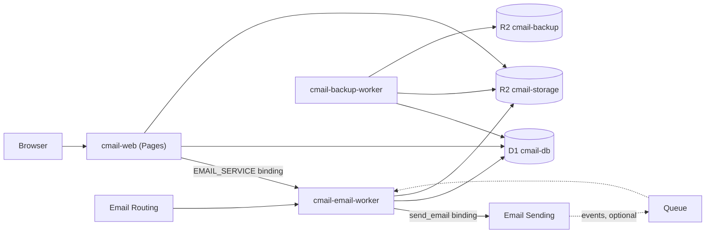

# How cmail runs on Cloudflare

cmail is four deployables that share one D1 database and one R2 bucket. This
page lists each one, its bindings and schedules, and how they connect. The
default resource names here (`cmail-web`, `cmail-db` and so on) come from the
`*.example` Wrangler files; yours can differ. To set them up, follow
[Getting started](getting-started.md) and [Deployment](deployment.md).

## The deployables

### Web app: `apps/web`

A SvelteKit app on **Cloudflare Pages**, built with
`@sveltejs/adapter-cloudflare`. It serves the mail UI, sign-in, administration
and the MCP endpoint for AI apps.

| Binding | Type | Default resource |
|---|---|---|
| `DB` | D1 | `cmail-db` (migrations in `packages/shared/migrations`) |
| `STORAGE` | R2 | `cmail-storage` |
| `EMAIL_SERVICE` | Service binding | `cmail-email-worker` |

Pages can't hold a `send_email` binding, which is why outbound mail goes
through the email Worker. Settings go in `[vars]` and Pages secrets; see the
[Configuration reference](configuration.md). The `[env.preview]` block points
at separate preview resources and sets `OUTBOUND_PROVIDER = "none"`, so a
preview can never send real mail.

### Email Worker: `apps/email-worker`

A **Worker** with four handlers in `src/index.ts`:

| Handler | Job |
|---|---|
| `email()` | Receives mail from Email Routing. See [How receiving works](receiving.md) |
| `fetch()` | Only `POST /internal/send`, reachable only over the service binding. See [How sending works](sending.md) |
| `queue()` | Optional. Delivery events. See [Delivery status and bounces](delivery-and-bounces.md) |
| `scheduled()` | Retention at `17 3 * * *` (when `RETENTION_JOBS_ENABLED="true"`), and the link blocklist refresh at `7 * * * *` |

Bindings: `DB`, `STORAGE`, `[[send_email]] name = "EMAIL"`, three rate-limit
bindings (they only record activity, and never block mail), and the optional
queue consumer. The Worker has no public URL: `workers_dev = false`,
`preview_urls = false`, `routes = []`.

Secrets: `INBOUND_SENDER_HASH_KEY` (required; without it, sender rate limits
fail closed) and `VAPID_PRIVATE_KEY` (only for push notifications).

### Backup Worker: `apps/backup-worker` (optional, recommended)

A scheduled Worker (cron `23 * * * *`) with no URL.

- Each hour it copies new and changed R2 objects from `cmail-storage` to
  `cmail-backup` under `objects/`. If an object changed, the old copy is kept
  under `versions/`.
- Once a day it exports every D1 table as NDJSON under `d1/<day>/`, with the
  schema and a `complete.json` marker, and writes a manifest.
- Copies of deleted objects, old versions, manifests and D1 exports are
  removed after `BACKUP_RETENTION_DAYS` (default 30, allowed 7 to 365).
  Lowering it also shortens how far back you can restore D1.
- It stops if the two buckets look swapped, or if too many objects vanish at
  once (`BACKUP_MAX_MISSING_SHARE`, default 20%, and never fewer than 25
  objects). That suggests a mistake or
  an attack, not normal use.

It is deployed separately: `pnpm setup`, `pnpm deploy` and `config:check`
don't cover it. Restoring is a manual job; see
[Running cmail: restore](operations.md#restore).

### Product page: `landing/` (optional)

A static Pages site with no bindings. Deploy it with
`pnpm deploy:landing --project-name <name>`. It contains upstream links and
analytics settings, so a fork should review `landing/insights.js` and
`landing/_headers` before deploying it.

## Cloudflare products

| Product | Needed? | Used for |
|---|---|---|
| Pages | Yes | Web app |
| Workers | Yes | Email Worker, backup Worker |
| D1 | Yes | All metadata |
| R2 | Yes | Bodies, attachments, staged sends, link list, backups |
| Email Routing | Yes | Inbound mail |
| Email Sending | Recommended | Outbound mail (Postmark is the alternative) |
| Cron Triggers | Yes | Retention, link list, backups |
| Queues | Optional | Delivery events and bounce notices |
| Turnstile | Optional | Bot check on the email-code sign-in form |
| Access | Optional | An extra gate in front of the site. See [Staff sign-in](staff-sign-in.md) |
| D1 Time Travel | Built in | Point-in-time restore of the database |

Check Cloudflare's current plan limits and prices before choosing a plan.

## Database migrations

There are 20 forward-only migrations in `packages/shared/migrations/`, from
`0001_initial.sql` to `0020_delivery_event_details.sql`. There are no down
migrations, so roll back with a backup or Time Travel.

| Command | Does |
|---|---|
| `pnpm db:migrate` | Applies new migrations to production D1 |
| `pnpm db:migrate:local` | Applies them to local D1 state |
| `pnpm db:migrate:preview` | Applies them to the preview D1 |
| `pnpm db:migrate:verify` | Applies all of them to a throwaway D1 and checks the tables, triggers and upgrade fixtures |

The first three run `config:check` first.

## What `config:check` enforces

`scripts/verify-wrangler-config.mjs` reads the example and active Wrangler
files for the web app and the email Worker. It fails if:

- the Worker has a public URL;
- the Worker has anything other than one `send_email` binding named `EMAIL`;
- preview reuses a production name or ID, or can send mail;
- a `DB`, `STORAGE` or `EMAIL_SERVICE` binding is missing or doubled;
- the rate-limit bindings are missing or share namespace IDs;
- the web app and the Worker point at different D1 or R2 resources.

It does **not** check `[vars]`, crons, compatibility dates, queues or the
backup Worker. See [Upgrading and keeping your settings](upgrading.md#after-pulling-check-for-new-settings)
for what to check by hand.
